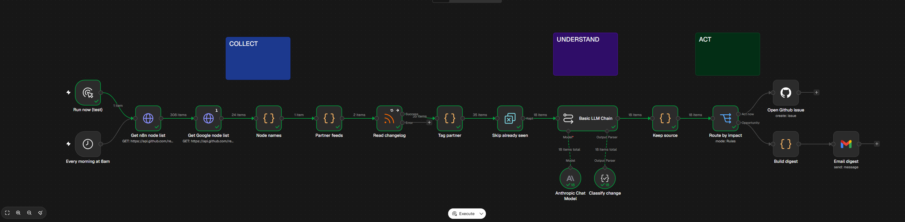

# Partner Pulse
A daily radar for partner API changes, built in n8n.

Every morning it reads the GitHub and Google Workspace changelogs,
asks an LLM whether each entry is breaking, deprecated or new, and maps it to the n8n node it affects
(using the live node list from n8n's repo, so it can't invent nodes).

- Breaking changes and deprecations → GitHub issues, with severity and a suggested action
- New partner features → a daily "node opportunities" email
- Re-runs never create duplicates, a broken feed doesn't stop the run, and failures send an alert

## How it works
1. **Collect:** fetch n8n's node list (including the Google nodes), read both changelog feeds, tag each entry with its partner, and skip entries already seen in earlier runs.
2. **Understand:** an Anthropic model (temperature 0, structured output) classifies each entry as breaking, deprecation, new capability or irrelevant, and picks affected nodes only from the real list.
3. **Act:** confident breaking changes and deprecations open a labelled GitHub issue; new capabilities go into one digest email. A separate error workflow emails an alert if a run fails.

## Run it yourself
1. In n8n: **Import from file** → `partner-pulse.json`.
2. Add three credentials: Anthropic, GitHub, Gmail.
3. In **Open Github issue**, point owner and repository to your own repo, and create the labels `breaking` and `deprecation`.
4. In **Email digest**, change the recipient.
5. Run it with **Run now (test)**, then activate it.
